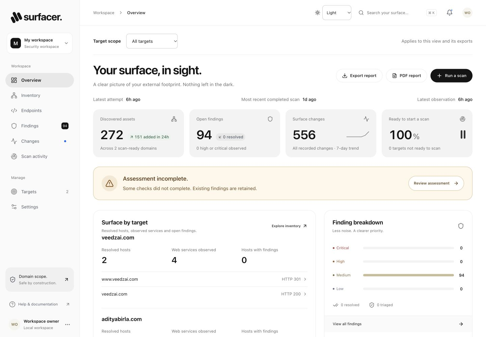
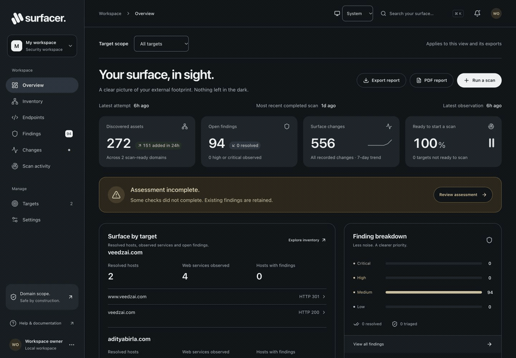
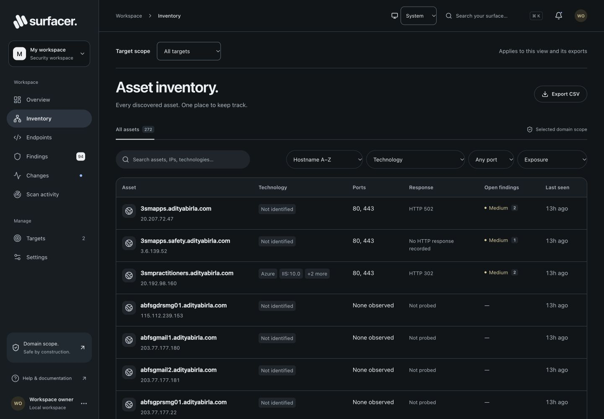
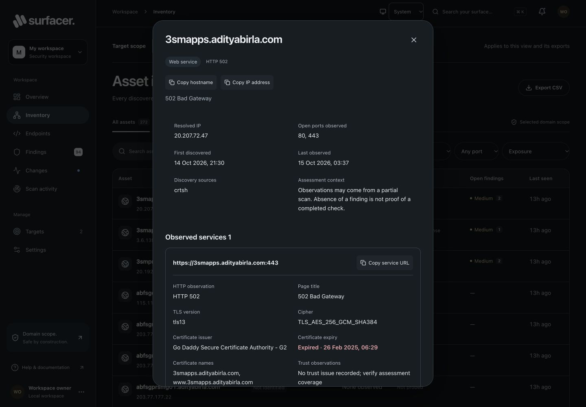
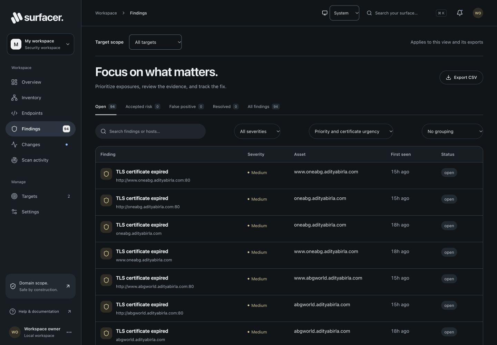
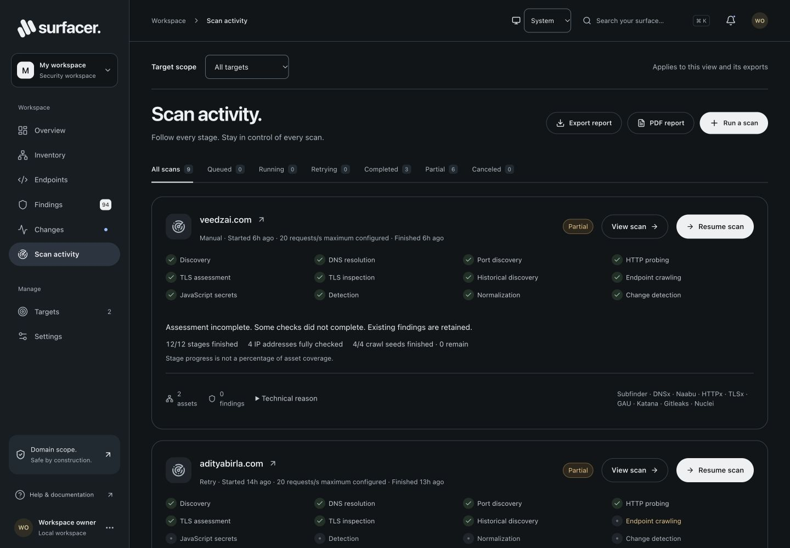

# Surfacer

A domain-scoped external attack surface application built from `PRD.md` and `design.md`: Next.js 16 / Tailwind v4 frontend, Go API and worker, PostgreSQL, S3-compatible evidence storage, and real ProjectDiscovery scanners.

## Live app preview

Captured from the running local app on 15 October 2026, using existing scan observations. Counts and assessment outcomes reflect that capture; new workspaces start empty.

| Dark appearance | Light appearance |
| --- | --- |
|  |  |

### Video walkthrough

The 41-second walkthrough covers the overview, asset inventory, service and TLS evidence, findings, scan activity, and switching to light mode. Click the animated preview to open the full-resolution video.

[](docs/media/surfacer-walkthrough.mp4)

[Watch or download the MP4 walkthrough](docs/media/surfacer-walkthrough.mp4) · 1440 × 1000 · no audio

<details>
<summary>More screenshots: inventory, evidence, findings, and scan activity</summary>

**Asset inventory**



**Asset evidence**



**Findings**



**Scan activity**



</details>

## Start the complete stack

Requires Docker Engine with Compose and Node 22+ for credential setup.

```sh
node scripts/setup.mjs
docker compose up -d --build
```

Open http://localhost:3000. Sign in with the `WORKSPACE_TOKEN` stored in `.env`. Setup generates independent random secrets and preserves existing values. The workspace starts empty and displays only your targets and real scan results. To use another frontend port, run `FRONTEND_PORT=3002 docker compose up -d`.

1. Add a root domain in **Targets**.
2. Click **Run a scan**. DNS ownership verification is optional by default. Progress and stage diagnostics stream to **Scan activity**.
3. Review inventory, evidence, findings and the change feed. Triage decisions require a note and are recorded in the audit log.

DNS verification remains available in target details. To require it, set `REQUIRE_DNS_VERIFICATION=true` in `.env` and recreate the API with `docker compose up -d api`. In required mode, publish the exact TXT value at `_surfacer.your-domain.com` and click **Check verification**. Ownership is then checked at scan creation, worker claim, each stage start, and every 15 minutes; missing proof pauses the target and cancels active scans. Optional mode skips these ownership gates without marking targets as verified.

Every scan stays within its selected root domain and subdomains. Private/internal IP destinations, out-of-scope redirects and the workspace kill switch remain enforced in both modes. The running stack is available on **http://localhost:3000**.

## What runs

| Service   | Purpose                                                                                                                     |
| --------- | --------------------------------------------------------------------------------------------------------------------------- |
| `web`     | Responsive workspace, session authentication, server-side Go API proxy                                                      |
| `api`     | Scope enforcement, durable queue, schedules, lifecycle, SSE, audit and evidence persistence                                 |
| `migrate` | One-shot migrations and restricted application database-role setup                                                          |
| `worker`  | Pinned open-source subprocess adapters, bounded JSONL output and checkpoint commits                                         |
| `gateway` | Authorized HTTP/CONNECT proxy, dial-time public-IP checks, scope and cancellation checks; pinned DNS relay                  |
| `db`      | PostgreSQL 17 with tables for targets, scans/checkpoints, assets, findings, changes, settings and append-only audit records |
| `minio`   | Private S3-compatible evidence store, built from the pinned official community security-release source                      |

Only the frontend is published to the host. The worker's **internal** Docker network has no direct internet route and is not attached to the database/object-store network. Target HTTP(S) connections pass through the gateway. The gateway checks the scan's HMAC-signed permit and active lease, re-resolves DNS before each dial, rejects every non-public IP (including metadata, loopback, mapped IPv6 and special-use ranges), and permits only ports 80/443. Redirects must make another authorized proxy request. Existing CONNECT tunnels check cancellation every three seconds. Passive discovery permits only the selected provider endpoints: crt.sh, HackerTarget and RapidDNS.

Scanners have no database or S3 credentials. All worker operations use a separate token and per-scan lease. No container receives the Docker socket or host networking. Runtime web/API/worker/gateway/MinIO services are non-root, have dropped capabilities and resource limits; scanner/API filesystems are read-only with temporary writable storage.

## Scanner pipeline

| Stage     | Implementation                                                                                                                                                                         |
| --------- | -------------------------------------------------------------------------------------------------------------------------------------------------------------------------------------- |
| Discovery | **Subfinder 2.17.0**, passive crtsh/hackertarget/rapiddns sources with provenance; selected root and previous inventory included                                                       |
| DNS       | **DNSx 1.3.1**, A/AAAA resolution through the gateway's pinned relay; non-public addresses listed but blocked from active steps; missing names independently checked before removal    |
| Ports | **Naabu 2.6.1**, unprivileged TCP connect on 35 common ports, lease-authenticated SOCKS egress, public domain-resolved IPs only |
| Historical | **GAU 2.2.4**, Wayback/Common Crawl, bounded separate history with query values removed |
| HTTP      | **HTTPx 1.12.0**, public web services, status, title, technologies, restricted redirects, deterministic scanner headers                                                                |
| TLS       | **TLSx 1.4.0**, negotiated TLS/cipher, certificate SAN/issuer/expiry and trust/name observations, plus Go expiry checks                                                                                                       |
| Crawl | **Katana 1.8.0**, scoped non-headless crawling, JS endpoint parsing, form extraction, robots/sitemap discovery, 2 rps, depth 3, 90-second budget |
| Secrets | **Gitleaks 8.30.1**, public JavaScript only; local ephemeral files; masked findings; no credential validation |
| Detection | **Nuclei 3.11.1**, immutable signed curated HTTP templates, technology-specific Apache/Nginx checks, excluded dos/intrusive/fuzz/bruteforce tags, no public interactsh or cloud upload |
| Normalize | Stable finding fingerprints, preserved first-seen/triage notes, redacted and size-capped evidence in MinIO                                                                             |
| Changes   | New/returned/removed assets, port changes, new/reopened/resolved findings and completed/partial scan events                                                                            |

Official release archives are checked against their published SHA-256 checksums. The worker image includes upstream scanner licenses. The curated set is pinned to **nuclei-templates v10.5.0**; files, hashes, original source URLs and technology gates are in `backend/templates/manifest.json`. Nuclei also rejects unsigned or mismatched signatures at execution. The reviewed set has 14 templates, covering exposed `.env` variants, Git/SVN/CI configuration, AWS credentials, PHP information, metrics, API documentation, GraphQL consoles and selected service configuration/status endpoints. Larger checks are technology-gated; sensitive new configuration matches omit raw response bodies. This is deliberately a small initial detection set, not the entire upstream CVE catalog. Expand it through review, update the manifest, and rebuild the worker.

MinIO's upstream community Docker images are unavailable. `deploy/Dockerfile.minio` builds the official security-release source at commit `9e49d5e7a648f00e26f2246f4dc28e6b07f8c84a` (RELEASE.2025-10-15T17-29-55Z) and includes its AGPLv3 license. The source URL is pinned in the Dockerfile. The API also supports an externally maintained S3 endpoint via `S3_ENDPOINT`, `S3_TLS`, `S3_ACCESS_KEY`, `S3_SECRET_KEY`, and `S3_BUCKET`.

## Reliability and lifecycle

- Durable scan checkpoints live in Postgres. A worker leases one scan, persists each stage, and heartbeats every two seconds.
- Expired 30-second leases return unfinished work to the queue. A replacement worker reuses completed stages. Stale leases cannot commit results.
- Stage failures retry up to three claims with backoff. Exhausted failures are **partial** and preserve available results.
- A scan has a 60-minute worker timeout and a 75-minute overall active deadline. Other subprocess stages have seven-minute timeouts. Port discovery uses a workload-aware budget of 7–40 minutes and batches of up to five addresses with three-minute limits (smaller batches at low configured rates); finished address/port sets are checkpointed after each batch. Bounded output and process-group cancellation still apply.
- Canceling a scan or enabling the workspace kill switch revokes authorization. Workers stop on their next heartbeat; the gateway also closes revoked tunnels.
- Findings resolve only after **two successful scans with explicit coverage of that host and template**. Partial scans, missing responses, blocked hosts, and templates that did not run cannot close findings. Accepted-risk and false-positive decisions remain suppressed; resolved issues reopen when rediscovered.
- Assets are removed only after two successful scans with confirmed DNS absence. DNS failures/timeouts never count as absence.
- Daily/weekly schedules are enforced by the API. Only one queued/running scan per target is permitted. Rates are capped at 30 requests/s; concurrency at 10. Settings are captured into each scan.
- Evidence is redacted before persistence, capped at 16 KiB per finding, and displayed as inert text. Raw evidence/stage objects are cleaned up according to the configured retention policy every 15 minutes. Finding summaries and audit records are retained.
- Application database credentials cannot change schema or update/delete audit records. A database trigger separately enforces append-only audit entries.

Scale workers with `docker compose up -d --scale worker=3`. This release uses **one API process and one workspace**; do not scale the API service. Back up both Postgres and evidence volumes. Restarting services preserves inventory, triage decisions and queued checkpoints.

## Verify

```sh
npm run typecheck
npm run build
GOMODCACHE=/private/tmp/surfacer-go-mod GOCACHE=/private/tmp/surfacer-go-build npm run test:api
# Real scanner integration against an owned loopback fixture; external networking disabled:
docker build -f backend/Dockerfile.worker --target test -t surfacer-native-test .
docker run --rm --network none --read-only --tmpfs /tmp:rw,nosuid,size=256m surfacer-native-test
docker compose ps
docker compose logs --tail=30 worker api gateway
```

The native test image is a separate build target. Its fixture-only DNS/dial injection is compiled into the **test executable**, never the production worker binary. It exercises the real Subfinder, DNSx, HTTPx, Katana, Gitleaks and Nuclei programs, the Go API's lease/stage endpoints, the scope gateway, normalization, finding evidence and scanner attribution. The fixture exposes known environment/Git files; the test requires both real detections and redacted credentials. Other tests cover DNS ownership loss, private/rebinding IP rejection, permit expiry/tampering, lease recovery, stale-worker rejection, subprocess cancellation, triage, transaction rollback and conservative lifecycle resolution.

## Frontend-only development

```sh
npm install
npm run dev
```

The development launcher starts loopback Next.js and a local JSON-backed API. Without the Compose worker stack, live scans return an explicit unavailable response. New workspaces start empty; only added domains and real worker results populate the application. Development data lives in `backend/data/workspace.json`; the Docker stack uses separate durable Postgres volumes.

## API and phase boundary

Public authenticated endpoints: `GET /api/state`, `GET /api/events` (SSE), `GET /api/health`, `POST /api/targets`, `POST /api/targets/{id}/verify`, `PATCH /api/targets/{id}`, `POST /api/scans`, `POST /api/scans/{id}/cancel`, `PATCH /api/findings/{id}`, `PATCH /api/settings`. The Next.js session is HttpOnly, SameSite=Strict, eight-hour, and Secure over HTTPS. Use an HTTPS reverse proxy before exposing the frontend remotely. The bootstrap owner token administers individual owner/analyst/viewer members under Settings → Access. Member keys are shown once, stored as SHA-256 hashes, expire within 1–90 days and can be revoked; disabling a member invalidates their keys. SSO/MFA and multiple organizations remain outstanding.

The implemented live backend covers the core domain-scoped web-scanning workflow. Verified CIDR targets, daily KEV/EPSS enrichment, external alert delivery, SSO/MFA, multitenant isolation and optional Jev remain outstanding. Domain-derived Naabu scanning, GAU history, member API keys and PDF reports are implemented. AI triage is off and no evidence is sent to third-party AI services. There is no exploitation, credential guessing or WAF evasion.

## DNS verification troubleshooting

Ownership checks in Docker use `EGRESS_DNS` through the gateway because the API has no direct internet route. A resolver outage returns HTTP 503; a missing or mismatched public TXT proof returns HTTP 422. Publish the exact value from Targets at `_surfacer.<domain>` (in Cloudflare, enter `_surfacer` as the TXT record name). A record at the root domain does not prove ownership. Authoritative DNS can update before recursive caches expire.

## Traffic pacing and rate-limit responses

The gateway admits at most two concurrent plain HTTP requests per domain and spaces new HTTP requests / HTTPS tunnel connections by at least 500 ms, with small added jitter. These limits are shared across workers. HTTPS tunnels have a separate limit of ten per domain; establishing a tunnel releases the request-admission slot so persistent HTTPS connections cannot starve HTTP requests. Scanner rate and concurrency settings still apply; the gateway adds an independent ceiling. Discovery providers receive their own shared pacing bucket.

User-Agent variants always identify `Surfacer/1.0`; HTTP proxy requests vary by scan/path, and HTTPS scanner headers vary by scan/stage. They do not impersonate browsers. HTTP 403/429/503 responses establish a shared cooldown with exponential backoff; `Retry-After` seconds and HTTP dates extend that cooldown. A successful concurrent response cannot shorten it. Workers also report observed throttling, and HTTP/HTTPS header checks before detection honor `Retry-After` and skip blocked hosts. These skips produce partial coverage and preserve existing findings.

HTTPS tunnel payloads remain encrypted. The gateway therefore paces tunnel creation rather than every HTTPS request; scanner limits bound requests inside tunnels. HTTPS scanner output is processed after the subprocess finishes, so cooldown reporting is not immediate for every response. Gateway cooldowns are in memory and reset when the gateway restarts. Header rotation does not guarantee that a service will permit scanning.

## Endpoint inventory and public JavaScript analysis

New scans include Endpoint crawling and JavaScript secrets stages. The Endpoints screen shows real Katana observations and exports the current filters as CSV. Inventory stores URL paths and query parameter names, with captured values removed; page bodies and form values are never persisted there. Endpoint records live with their owning asset in PostgreSQL and preserve first/last seen timestamps. Removal requires two clean completed crawls; partial scans retain earlier records.

Gitleaks analyzes only public JavaScript downloaded through the scope gateway: at most 100 files, 512 KiB/file and 16 MiB total. Findings identify the rule and affected file; credentials are masked and are not tested for validity. Form extraction does not enable automatic form filling. Existing scans keep their recorded pipeline; run a new scan to obtain endpoints and JavaScript findings.

See [PRD_IMPLEMENTATION.md](PRD_IMPLEMENTATION.md) for the requirement audit and the remaining work before competitive production claims.

## Access, reports and operations

Settings → Access creates members and issues keys. Viewers can read; analysts can scan and triage findings; owners configure scope, schedules, settings and memberships. Member keys can sign into the browser or be sent as `Authorization: Bearer <member-key>` to `/api/*`. A disabled member or expired/revoked key is rejected, including subsequent SSE updates. Initial member keys expire in seven days. Use individual keys for automation, not the bootstrap token.

The API reference is `/openapi.json`. Example payloads: `POST /api/members` with `{"name":"Engineer","role":"analyst"}` (owner), `POST /api/api-keys` with `{"name":"Automation","days":7}` (member's own key), and `POST /api/api-keys/{id}/revoke` with `{}`. This reference lists routes/roles; complete request schemas and generated clients are still pending.

Download a PDF from the overview's PDF report button, or `GET /api/reports.pdf?targetId=<id>&severity=high&status=open`. Omit filters for the full workspace. PDFs contain real inventory, findings and scan status; raw evidence/notes are omitted. Limits are explicitly labeled. Owner-only `/api/metrics` exports Prometheus counts with no target/member/evidence labels. Neither metrics nor reports require outbound services.

`python3 scripts/backup.py /absolute/path/to/new-backup.dump` creates a mode-0600 PostgreSQL custom archive, a SHA-256 sidecar and verifies the archive index. It never overwrites an existing file or restores over production. Back up the S3 evidence bucket separately with your S3 backup tooling. Restore into a new isolated PostgreSQL instance with `pg_restore --no-owner --no-acl --dbname=<new-database> <backup.dump>`, then apply migrations/role grants and validate data before switching the deployment. The repository has not yet demonstrated a full database-plus-evidence disaster recovery drill.

Naabu targets only observed public addresses of the selected domain and 35 explicit ports (maximum 10 connect attempts/second). TCP tunnels have separate per-domain admission pacing and revoke within three seconds after cancellation. HTTP traffic retains the existing cooldown controls. Historical results are labeled unverified and never treated as live services merely because an archive listed them. TLSx reports the negotiated protocol/cipher, not exhaustive version/cipher enumeration.

See [PRD_IMPLEMENTATION.md](PRD_IMPLEMENTATION.md) for the implemented scope, measured checks and remaining release gaps.

### Large port-discovery scans

Port discovery previously ran every address in one process under the generic seven-minute stage limit. For 226 addresses and 35 ports at 10 checks/s, even the minimum runtime is over thirteen minutes. The worker now persists five-address batches, resumes completed batches after interruption, and derives a capped stage budget from the workload. SOCKS TCP dialing has a one-second deadline so filtered ports cannot occupy gateway capacity for ten seconds after a scanner abandons them. Rate limits are unchanged.

Unfinished port coverage is explicitly partial; observed open ports survive and previously observed ports are retained for unchecked addresses. A partial/failed scan can be resumed with the Scan activity → Resume scan button or `POST /api/scans/{id}/retry`. This creates a new run from saved stages/checkpoints while preserving the original scan history. The API rejects concurrent target retries, paused scanning, lost ownership and revoked access. A later resume retries unfinished addresses instead of repeating completed address batches.

### Coverage warnings and scanner gateway DNS

The scanner's public DNS resolver cannot resolve Docker service names such as `gateway`. Before launching tools, the worker resolves the trusted gateway with Docker/system DNS and passes its literal address to scanner proxies. This prevents HTTPx from silently treating a gateway DNS error as zero web services. HTTPx now reports failed probes; hosts with no successful probe remain incomplete rather than being considered clean.

Non-public resolved hosts remain blocked from active scanning and are listed as policy exclusions. These expected exclusions do not by themselves fail otherwise completed public coverage. Real HTTP/detection failures and unfinished port checks still produce partial scans and retain unchecked findings. Scan activity shows the exclusion count and specific coverage warnings. Port-stage budgets now consider unfinished addresses and are capped at forty minutes; active gateway permits cover the sixty-minute worker budget while cancellation and lease checks remain enforced on every request.

### Coverage fix validation — 15 October 2026

The resumed affected workload ultimately completed all 224 eligible IPs. HTTPx had been sending the Docker proxy hostname to the public scanner resolver, producing zero live services. A scoped probe returned “no address found for host” with the service-name proxy and HTTP 307 using the same gateway's internal IP. The worker now resolves that trusted gateway with system/Docker DNS before launching scanners.

A regression fixture also identified HTTP starvation from persistent HTTPS tunnels. Separate bounded tunnel capacity fixes it without removing request pacing, scope validation or cancellation. Non-public hosts are exclusions; genuinely failed checks remain incomplete. Both findings and endpoints on excluded hosts retain their unchecked history.

Backend race tests and the real nine-scanner Docker fixture passed. The fixed images were deployed, and run `dfe1b7ec3e57938a0a81e869507a62a9` resumed at HTTP probing with all 224 port checkpoints retained. Its full completion was still pending during this validation; the prior partial scans remain in history.

The large HTTP pass reached its stage budget, so the worker now retains completed probe records and explicitly marks missing responses incomplete. A regression test confirms positive service data survives a deadline; service-origin matching also normalizes default HTTP/HTTPS ports. The final native pipeline passed in sixty seconds. In the deployed affected run, HTTP probing committed 119 live web hosts while preserving all 224 completed port-address checks; TLS inspection was still running at verification. These are observed results, not a claim that every remote host responded or the full scan completed.


### Resumable Katana crawling — 15 October 2026

The affected scan reached Endpoint crawling with 203 web services across 119 live hosts. A single serial Katana process received only the generic seven-minute stage deadline; killing it discarded all crawl output and stopped downstream stages. Katana now runs one deduplicated service origin per invocation under its existing 90-second, depth-three, 200-page profile, with a 110-second process guard. The stage budget follows unfinished seed count, bounded to seven–twenty minutes, and leaves time to commit before starting another seed. Rate limits, scope checks, form extraction without submission, and query-value omission remain enforced.

Each finished service and its discovered endpoints are committed through the authenticated stage checkpoint API. A timed-out process retains complete JSONL records, ignores a truncated last record, and leaves its seed unfinished. Bounded crawl passes continue to JavaScript analysis and detection with collected data; unfinished crawl coverage makes the overall scan partial and cannot advance endpoint removal. Resume scan preserves completed service checkpoints and endpoint inventory and reopens crawling plus downstream stages. Large inventories can require multiple bounded passes; completed seeds are not crawled again. Completion refers to this bounded profile, not exhaustive website coverage.

Validation: backend race/regression tests passed, including truncated-output retention, deduplicated resume, durable progress without extra attempts, partial completion, endpoint retention and seed-scope rejection. The real nine-scanner Docker pipeline passed in 59.75 seconds. Fixed images were deployed. Run `871273d1e680dee33eaeda76725cde91` resumed the affected scan at Endpoint crawling with earlier stages preserved; its first durable checkpoint contained five real endpoints and one of 197 deduplicated eligible service seeds completed. The remaining crawl was still running at this check; full remote coverage is not claimed.

### Operational UI/UX fixes — 15 October 2026

Target scope stays visible across investigation views. Assessment completeness is distinguished from scan readiness, legacy interrupted stages no longer appear active, and saved crawl/port counts are shown separately from stage progress. Mobile exposes scan recovery actions, and inventory/findings/endpoints use responsive records with pagination. Service/TLS evidence is organized per origin, expired certificate conditions are labeled precisely, and URL state preserves scope, filters and entity details through Back and refresh. See [UI_UX_FIXES.md](UI_UX_FIXES.md) for the implementation plan, verification and screenshots.

### Light, dark and system appearance

Use the Appearance selector in the header or Settings → General → Appearance. The preference applies immediately, persists in this browser and synchronizes across open tabs. System mode follows the device appearance, including changes while the app is open. A small head script applies the saved theme before React starts; storage failures fall back to system appearance and manual selections still work for the current tab. Appearance is a local preference, separate from workspace settings and authentication.

Both palettes cover navigation, metrics, tables, forms, service evidence, dialogs and semantic severity/coverage indicators. Mobile controls remain 44px high. Printing uses a light palette. Production builds, a twenty-case theme initialization matrix (including blocked storage), desktop/mobile browser checks, refresh persistence and cross-tab synchronization passed. Main text and semantic warning/critical color pairs checked above 4.5:1 contrast; this is not a complete accessibility conformance audit. Preview artifacts are in `output/playwright/appearance/`.
