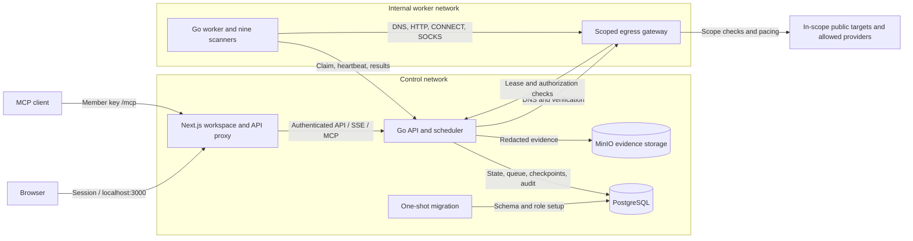

# Surfacer

**Your surface, in sight.**

Self-hosted external attack surface monitoring for domains you manage. Discover hosts, ports, web services, endpoints, and exposed configuration; investigate evidence and track what changes between scans.

[Quick start](#quick-start) · [Live preview](#live-app-preview) · [Architecture](#architecture) · [MCP access](#mcp-access) · [Documentation](#documentation) · [Contributing](CONTRIBUTING.md)

## Why Surfacer

- **Real observations:** nine open-source scanners feed a shared inventory with discovery provenance, service details, and TLS evidence.
- **Investigation in one place:** filter assets and endpoints, inspect findings, review DNS posture and takeover candidates, record triage decisions, and export CSV or PDF reports.
- **Record cleanup:** owners can select rows, a page, or all filtered results and delete findings, inventory, endpoints, finished scan history, hazards, and takeovers from active views. [Internal history is retained](docs/operations.md#delete-records-from-active-views).
- **Recoverable scans:** bounded concurrency, workload-aware budgets, and durable checkpoints for completed port batches, crawl seeds, and detection services. Resume retries unfinished work.
- **Live finding visibility:** findings publish into the workspace as each stage and detection batch commits, with consolidated stage logs.
- **Coverage-aware history:** incomplete checks retain prior findings, endpoints, and takeover candidates instead of treating missing results as resolved (two clean completed scans required for resolution).
- **Self-hosted storage:** PostgreSQL for workspace state and MinIO for evidence, with an isolated worker network and scoped egress gateway.
- **Responsive workspace:** light, dark, and system appearance; mobile layouts; shareable view state through URL filters.
- **AI client access:** ten authenticated [MCP tools](docs/mcp.md) for filtered inventory, findings, scan status, start/resume/cancel controls, and member-attributed triage.

Surfacer is under active development. The current deployment supports one workspace and one API process, with scalable workers. See [current limits](#current-limits) before planning a deployment.

## Quick start

Requires **Docker Engine with Compose v2** and **Node.js 22+**. Go and scanner binaries are built inside Docker.

```sh
git clone https://github.com/suryanshp1/attack-surface.git
cd attack-surface
node scripts/setup.mjs
docker compose up -d --build
```

Open [localhost:3000](http://localhost:3000) and sign in with `WORKSPACE_TOKEN` from the generated `.env` file. Setup preserves existing values and generates independent credentials. Keep `.env` private. The first build downloads the pinned scanners and builds the evidence-storage image from source.

1. Add a root domain in **Targets**.
2. Choose **Run a scan** and follow stages in **Scan activity**.
3. Explore **Inventory**, **Endpoints**, **Findings**, and **Changes**. Record a note when triaging a finding.

New workspaces start empty. DNS ownership verification is optional by default; operators can require it with `REQUIRE_DNS_VERIFICATION=true`. Active scans remain constrained to public destinations within the selected domain. Only scan systems you are authorized to assess.

```sh
# Check service health and worker diagnostics
docker compose ps
docker compose logs --tail=50 worker api gateway

# Stop services while retaining database and evidence volumes
docker compose down
```

For configuration, HTTPS deployment, backups, scaling, and troubleshooting, see the [operations guide](docs/operations.md).

## Live app preview

Captured from the running local app on 15 October 2026, using existing scan observations. Counts and assessment outcomes reflect that capture; new workspaces start empty.

| Dark appearance | Light appearance |
| --- | --- |
|  |  |

### Video walkthrough

The 41-second walkthrough covers the overview, asset inventory, service and TLS evidence, findings, scan activity, and switching to light mode. Click the animated preview to open the full-resolution video.

[](docs/media/surfacer-walkthrough.mp4)

[Watch or download the MP4 walkthrough](docs/media/surfacer-walkthrough.mp4) · 1440 × 1000 · no audio

<details>
<summary>More screenshots: inventory, evidence, findings, and scan activity</summary>

**Asset inventory**


**Asset evidence**


**Findings**


**Scan activity**


</details>

## Architecture



Only the web service publishes a host port, bound to loopback by default. The worker has no direct internet route or database/object-store credentials. It commits results through the API and sends scanner traffic through the gateway. Network membership and trust boundaries are detailed in [architecture](docs/architecture.md).

## Open-source scanning pipeline

| Capability | Tool | Pinned version |
| --- | --- | --- |
| Passive subdomain discovery | Subfinder | 2.17.0 |
| DNS resolution | DNSx | 1.3.1 |
| Domain-derived TCP port discovery | Naabu | 2.6.1 |
| Web services and technology identification | HTTPx | 1.12.0 |
| TLS and certificate inspection | TLSx | 1.4.0 |
| Historical URL discovery | GAU | 2.2.4 |
| Endpoint crawling | Katana | 1.8.0 |
| Public JavaScript secret detection | Gitleaks | 8.30.1 |
| Curated exposure checks | Nuclei | 3.11.1 |

Scanner versions and checksum verification live in [the downloader](scripts/fetch-scanners.py). Nuclei runs a reviewed set of 14 signed templates pinned to `nuclei-templates v10.5.0`; it does not run the entire upstream catalog. See [scanning and coverage](docs/scanning.md) for scope, budgets, lifecycle rules, and recovery behavior.

Scanners use bounded worker pools and shared gateway pacing. Egress plain HTTP requests and HTTPS tunnels are paced dynamically by the scan's signed permit rate and concurrency, while the gateway DNS relay forwards A, AAAA, TXT, CNAME, and MX queries. Nuclei groups curated templates by matching technology, runs up to three parallel worker subprocesses on batches of up to 50 URLs, streams scanner JSONL line by line, and skips dead hosts (`-mhe 5`) before exhausting budgets. Findings publish progressively as each stage or batch checkpoint commits.

Incomplete stages and failed or skipped JavaScript downloads cannot establish clean coverage. Findings, removed assets, endpoints, and subdomain takeovers strictly require two consecutive clean, successful scans confirming absence before resolution. Use **Scan activity → Resume scan** to continue a failed or partial assessment from its earliest unfinished stage; reusable checkpoints survive, and the original run remains in history. Stage progress describes pipeline execution, not the percentage of assets assessed.

## MCP access

Open **Settings → MCP** for the deployment endpoint, copyable configuration, setup guide, tool permissions, and troubleshooting. Connect a compatible Streamable HTTP client to **`http://localhost:3000/mcp`**, or `/mcp` on your deployed HTTPS web URL. Create an expiring member key under **Settings → Access** and configure the client with `Authorization: Bearer <member-access-key>`.

| Tools | Minimum role |
| --- | --- |
| `list_targets`, `list_assets`, `list_findings`, `list_endpoints`, `list_scans` | Viewer |
| `get_scan` for one scan's status, stage logs, and coverage | Viewer |
| `start_scan`, `resume_scan`, `cancel_scan` | Analyst |
| `triage_finding` with a decision and required note | Analyst |

Owners with member keys can use all tools. List tools support target filters, pagination, and applicable status/severity filters. Scan actions use the same readiness, pause, ownership, and duplicate-run checks as the workspace. Triage notes retain the member's identity; findings resolve through successful coverage rather than manual triage.

See [MCP integration](docs/mcp.md) for client configuration, tool arguments, response limits, and trust considerations. Clients need Streamable HTTP and custom Bearer-header support; OAuth-only and local-stdio-only integrations are not implemented.

## Documentation

| Guide | Contents |
| --- | --- |
| [Architecture](docs/architecture.md) | Services, networks, scan flow, storage, and access model |
| [Operations](docs/operations.md) | Configuration, deployment, backups, monitoring, and troubleshooting |
| [Scanning and coverage](docs/scanning.md) | Scanner profiles, checkpoints, partial results, and lifecycle rules |
| [Development](docs/development.md) | Local setup, repository layout, and validation commands |
| [API reference](public/openapi.json) | Routes and roles; served at `/openapi.json` |
| [MCP integration](docs/mcp.md) | AI client setup, tools, filters, scan resume, authentication, and limits |
| [Contributing](CONTRIBUTING.md) | Bug reports, feature proposals, and pull requests |
| [Security policy](SECURITY.md) | Vulnerability reporting and supported scope |
| [Third-party notices](THIRD_PARTY_NOTICES.md) | Bundled tools, templates, and upstream license locations |

## Current limits

- Domain targets only; verified CIDR targets are not implemented.
- One workspace and one API process; no organization isolation, SSO, or MFA.
- Detection uses a small curated template set. TLS inspection reports negotiated protocol/cipher, not exhaustive enumeration.
- Large inventories can require multiple bounded scan passes. Partial scans preserve data; they do not establish complete coverage.
- Configured Slack, Discord, and generic webhooks use best-effort delivery; durable delivery queues and retries are not implemented. Daily KEV/EPSS enrichment is not implemented.
- The OpenAPI reference lists routes and roles; complete request schemas and generated clients are pending.
- A complete database-plus-evidence disaster recovery drill remains outstanding.

## Contributing

Bug reports, documentation improvements, scanner reliability fixes, and reviewed detection templates are welcome. Start with [CONTRIBUTING.md](CONTRIBUTING.md), use [issues](https://github.com/suryanshp1/attack-surface/issues) for reproducible bugs or feature proposals, and follow [SECURITY.md](SECURITY.md) for vulnerabilities.

## License

Surfacer's own code is licensed under [Apache-2.0](LICENSE). Third-party scanners, templates, dependencies, and bundled development tooling retain their upstream licenses; see [third-party notices](THIRD_PARTY_NOTICES.md).
