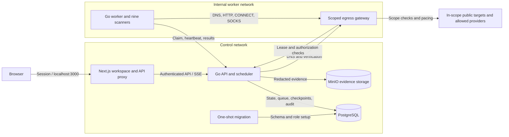

# Surfacer

**Your surface, in sight.**

Self-hosted external attack surface monitoring for domains you manage. Discover hosts, ports, web services, endpoints, and exposed configuration; investigate evidence and track what changes between scans.

[Quick start](#quick-start) · [Live preview](#live-app-preview) · [Architecture](#architecture) · [Documentation](#documentation) · [Contributing](CONTRIBUTING.md)

## Why Surfacer

- **Real observations:** nine open-source scanners feed a shared inventory with discovery provenance, service details, and TLS evidence.
- **Investigation in one place:** filter assets and endpoints, inspect findings, record triage decisions, and export CSV or PDF reports.
- **Recoverable scans:** durable stage checkpoints, worker leases, bounded scanner runs, and resume support for interrupted work.
- **Coverage-aware history:** incomplete checks retain prior findings and endpoints instead of treating missing results as resolved.
- **Self-hosted storage:** PostgreSQL for workspace state and MinIO for evidence, with an isolated worker network and scoped egress gateway.
- **Responsive workspace:** light, dark, and system appearance; mobile layouts; shareable view state through URL filters.

Surfacer is under active development. The current deployment supports one workspace and one API process, with scalable workers. See [current limits](#current-limits) before planning a deployment.

## Quick start

Requires **Docker Engine with Compose v2** and **Node.js 22+**. Go and scanner binaries are built inside Docker.

```sh
git clone https://github.com/suryanshp1/attack-surface.git
cd attack-surface
node scripts/setup.mjs
docker compose up -d --build
```

Open [localhost:3000](http://localhost:3000) and sign in with `WORKSPACE_TOKEN` from the generated `.env` file. Setup preserves existing values and generates independent credentials. Keep `.env` private. The first build downloads the pinned scanners and builds the evidence-storage image from source.

1. Add a root domain in **Targets**.
2. Choose **Run a scan** and follow stages in **Scan activity**.
3. Explore **Inventory**, **Endpoints**, **Findings**, and **Changes**. Record a note when triaging a finding.

New workspaces start empty. DNS ownership verification is optional by default; operators can require it with `REQUIRE_DNS_VERIFICATION=true`. Active scans remain constrained to public destinations within the selected domain. Only scan systems you are authorized to assess.

```sh
# Check service health and worker diagnostics
docker compose ps
docker compose logs --tail=50 worker api gateway

# Stop services while retaining database and evidence volumes
docker compose down
```

For configuration, HTTPS deployment, backups, scaling, and troubleshooting, see the [operations guide](docs/operations.md).

## Live app preview

Captured from the running local app on 15 October 2026, using existing scan observations. Counts and assessment outcomes reflect that capture; new workspaces start empty.

| Dark appearance | Light appearance |
| --- | --- |
|  |  |

### Video walkthrough

The 41-second walkthrough covers the overview, asset inventory, service and TLS evidence, findings, scan activity, and switching to light mode. Click the animated preview to open the full-resolution video.

[](docs/media/surfacer-walkthrough.mp4)

[Watch or download the MP4 walkthrough](docs/media/surfacer-walkthrough.mp4) · 1440 × 1000 · no audio

<details>
<summary>More screenshots: inventory, evidence, findings, and scan activity</summary>

**Asset inventory**


**Asset evidence**


**Findings**


**Scan activity**


</details>


## Architecture



Only the web service publishes a host port, bound to loopback by default. The worker has no direct internet route or database/object-store credentials. It commits results through the API and sends scanner traffic through the gateway. Network membership and trust boundaries are detailed in [architecture](docs/architecture.md).

## Open-source scanning pipeline

| Capability | Tool | Pinned version |
| --- | --- | --- |
| Passive subdomain discovery | Subfinder | 2.17.0 |
| DNS resolution | DNSx | 1.3.1 |
| Domain-derived TCP port discovery | Naabu | 2.6.1 |
| Web services and technology identification | HTTPx | 1.12.0 |
| TLS and certificate inspection | TLSx | 1.4.0 |
| Historical URL discovery | GAU | 2.2.4 |
| Endpoint crawling | Katana | 1.8.0 |
| Public JavaScript secret detection | Gitleaks | 8.30.1 |
| Curated exposure checks | Nuclei | 3.11.1 |

Scanner versions and checksum verification live in [the downloader](scripts/fetch-scanners.py). Nuclei runs a reviewed set of 14 signed templates pinned to `nuclei-templates v10.5.0`; it does not run the entire upstream catalog. See [scanning and coverage](docs/scanning.md) for scope, budgets, lifecycle rules, and recovery behavior.

## Documentation

| Guide | Contents |
| --- | --- |
| [Architecture](docs/architecture.md) | Services, networks, scan flow, storage, and access model |
| [Operations](docs/operations.md) | Configuration, deployment, backups, monitoring, and troubleshooting |
| [Scanning and coverage](docs/scanning.md) | Scanner profiles, checkpoints, partial results, and lifecycle rules |
| [Development](docs/development.md) | Local setup, repository layout, and validation commands |
| [API reference](public/openapi.json) | Routes and roles; served at `/openapi.json` |
| [Contributing](CONTRIBUTING.md) | Bug reports, feature proposals, and pull requests |
| [Security policy](SECURITY.md) | Vulnerability reporting and supported scope |
| [Third-party notices](THIRD_PARTY_NOTICES.md) | Bundled tools, templates, and upstream license locations |

## Current limits

- Domain targets only; verified CIDR targets are not implemented.
- One workspace and one API process; no organization isolation, SSO, or MFA.
- Detection uses a small curated template set. TLS inspection reports negotiated protocol/cipher, not exhaustive enumeration.
- Large inventories can require multiple bounded scan passes. Partial scans preserve data; they do not establish complete coverage.
- External alert delivery and daily KEV/EPSS enrichment are not implemented. AI triage is disabled.
- The OpenAPI reference lists routes and roles; complete request schemas and generated clients are pending.
- A complete database-plus-evidence disaster recovery drill remains outstanding.

## Contributing

Bug reports, documentation improvements, scanner reliability fixes, and reviewed detection templates are welcome. Start with [CONTRIBUTING.md](CONTRIBUTING.md), use [issues](https://github.com/suryanshp1/attack-surface/issues) for reproducible bugs or feature proposals, and follow [SECURITY.md](SECURITY.md) for vulnerabilities.

## License

Surfacer's own code is licensed under [Apache-2.0](LICENSE). Third-party scanners, templates, dependencies, and bundled development tooling retain their upstream licenses; see [third-party notices](THIRD_PARTY_NOTICES.md).
