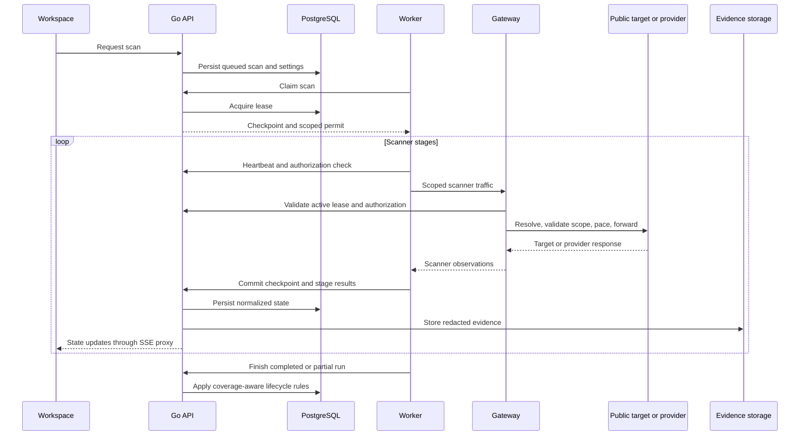

# Architecture

[Back to README](../README.md)

Surfacer combines a Next.js workspace with a Go control plane and scanner workers. The default Compose deployment runs one workspace and one API process. PostgreSQL persists workspace state; MinIO stores redacted evidence objects.

## Services and networks

The service definitions in [compose.yaml](../compose.yaml) are the source of truth.

| Service | Responsibility | Networks |
| --- | --- | --- |
| `web` | Next.js UI, browser session, server-side API proxy | `control` |
| `api` | Authorization, target scope, schedules, queue, checkpoints, SSE, reporting | `control`, `workers` |
| `migrate` | One-shot schema migration and restricted application role setup | `control` |
| `db` | PostgreSQL 17 workspace, inventory, findings, audit, scan state | `control` |
| `minio` | S3-compatible evidence storage | `control` |
| `worker` | Leased scan execution and pinned scanner subprocesses | `workers` |
| `gateway` | Scope-aware DNS, HTTP/CONNECT, and SOCKS egress | `workers`, `egress` |

Only `web` publishes a port: `127.0.0.1:3000` by default. The `workers` network is internal. Workers cannot directly reach the internet, PostgreSQL, or MinIO; results are committed through the API. The gateway bridges to the egress network and checks active authorization before forwarding traffic.

## Scan execution

Workers heartbeat every two seconds. Expired 30-second leases return unfinished work to the queue; stale workers cannot commit. Each stage persists checkpoints. Port discovery additionally checkpoints address batches; crawling checkpoints service seeds. Cancellation and the workspace kill switch revoke execution authorization.

## Scope and traffic boundaries

Targets are root domains and their subdomains. The gateway re-resolves destinations before dialing and rejects non-public addresses, including loopback, metadata, and private ranges. Non-public discoveries remain visible as excluded inventory. Target HTTP/CONNECT access is limited to ports 80/443; Naabu uses a separate scoped TCP path for its explicit port profile.

HMAC-signed scan permits, worker leases, target scope, and cancellation checks constrain egress. Redirect destinations must pass authorization again. Passive discovery is limited to configured provider endpoints. DNS verification can be required by the operator; disabling that requirement does not mark a domain verified.

Scanner processes receive no database or evidence-store credentials. Runtime services use restricted container settings; worker/API filesystems are read-only with temporary writable storage. Neither Docker socket access nor host networking is used.

## Persistence and access

- PostgreSQL holds targets, queued scans, checkpoints, inventory, endpoints, findings, triage, members, settings, and audit records.
- Evidence is redacted and size-capped before storage in MinIO. Finding summaries and audit history are retained separately from evidence retention.
- Application database credentials cannot modify schema or update/delete audit entries; a database trigger also enforces append-only audit history.
- Browser sessions use HttpOnly, SameSite=Strict cookies with an eight-hour lifetime and Secure over HTTPS.
- The bootstrap owner manages members. Owner, analyst, and viewer roles constrain API operations. Individual keys expire, can be revoked, and are stored as hashes.

The default evidence image builds a pinned upstream MinIO source revision. An alternative S3 endpoint requires a Compose override; see [operations](operations.md). Upstream licenses remain separate from Surfacer's license.

## Implementation map

| Path | Responsibility |
| --- | --- |
| `app/`, `components/`, `lib/` | Workspace, session/proxy routes, appearance, URL state, shared types |
| `backend/main.go`, `access.go`, `jobs.go` | API, access control, scheduling and durable scan coordination |
| `backend/worker.go`, `advanced_scanners.go`, `crawl.go` | Scanner execution, normalization, checkpoints |
| `backend/gateway.go`, `tcp_gateway.go`, `traffic.go` | Egress authorization, DNS, TCP proxying, pacing |
| `backend/storage.go`, `schema.sql` | PostgreSQL and evidence persistence |
| `backend/reports.go`, `metrics.go` | Reports and operational metrics |
| `backend/templates/` | Reviewed Nuclei templates and provenance manifest |

See [scanning](scanning.md) for lifecycle semantics and [operations](operations.md) for deployment constraints.
